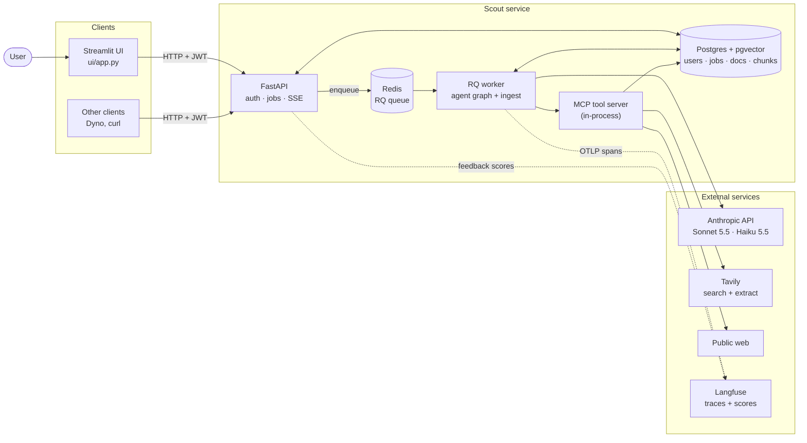
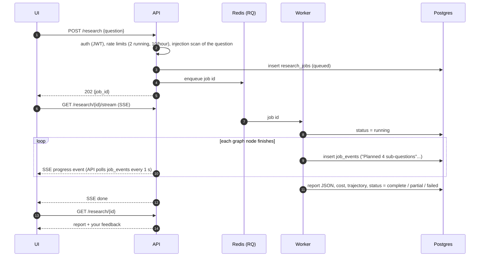
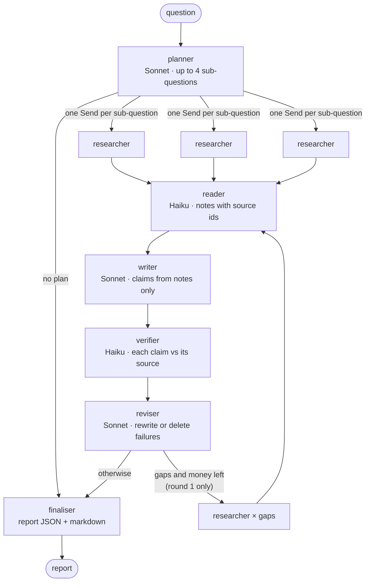
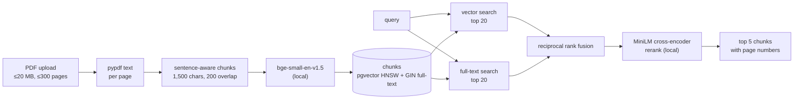

# Scout system design

Scout is a research agent. You ask a question; it plans the research, searches the web
and your own PDFs, reads the sources, writes a report, checks every claim against the
text it cites, and returns the report with each claim linked to its source.

This document explains how it is built and why. Every limit quoted here is taken from
[`config.yaml`](../config.yaml), which is the source of truth if the two ever differ.

**Contents:**
1. Goals and non-goals
2. Architecture
3. A research job from start to finish
4. The agent graph
5. Tools (MCP server)
6. Document search (RAG)
7. Guardrails
8. Data model
9. Observability
10. Evaluation
11. Key decisions
12. Known limitations and next steps

---

## 1. Goals and non-goals

**Goals:**
- **Trustworthy:** every claim cites a source, and the verifier checks it against that
  source's own words before the report goes out.
- **Bounded:** each report has a hard ceiling on cost (£0.20), model calls (50) and time
  (180 s). If a limit is hit, the user gets a partial report that says why, not an error.
- **Safe with untrusted text:** web pages and uploaded files are data, never instructions.
- **Observable and measurable:**
  - every model and tool call is traced
  - every run's step-by-step trajectory can be exported
  - a 50-question golden set measures quality

**Non-goals (out of scope):** multi-user collaboration, write actions (sending email,
posting), browser automation, voice, mobile apps.

---

## 2. Architecture

**Components:**
- **The API** handles accounts, uploads and jobs, and streams progress. It never runs
  the agent itself: it puts a job on the queue and returns at once.
- **The worker** runs research jobs and PDF ingest. It's a single long-lived process
  (RQ `SimpleWorker`), so the embedding and reranker models load once.
- **The UI** is just another HTTP client of the API, through `ScoutClient`. It has no
  database access, so it can run anywhere.
- **On a Windows laptop,** where RQ workers can't run, `JOBS_MODE=inline` makes the API run
  jobs itself with the same job code.

---

## 3. A research job from start to finish

**Robustness:**
- The SSE stream **resumes** from `Last-Event-ID`, so a dropped connection loses no
  progress lines.
- A job still "running" 600 s after it started has lost its worker, so it's **marked
  failed** instead of spinning forever.
- Someone else's job id answers **404**, not 403, so job ids can't be probed.

---

## 4. The agent graph

Built with LangGraph. The state is a typed dict: question, plan, evidence, notes,
claims, verification, budget and report.

| Node | Model, effort | Reads | Writes | Notes |
|---|---|---|---|---|
| planner | Sonnet 5.5, medium | question | ≤4 sub-questions (2+ unless the question is a single fact), search plan | No plan means straight to the finaliser (status failed) |
| researcher | Haiku 5.5, low | one sub-question | evidence (sources) | Runs in parallel; ≤3 tool rounds; offered only the tools the user enabled |
| reader | Haiku 5.5, low | ≤8 sources (≤8,000 chars each) | notes tagged `S1`, `S2`… | Notes are saved through the `save_note` tool |
| writer | Sonnet 5.5, medium | notes only | summary, sections of claims | Prompt `writer_v2`: one fact per claim |
| verifier | Haiku 5.5, medium | each source + its claims | verdict + 1–3 quotes per claim | Quotes checked **in code**, word by word, against the source |
| reviser | Sonnet 5.5, medium | failed claims + evidence | rewrites (re-verified) or deletions | May trigger **one** retry research round |
| finaliser | none | state | `Report` | Adds limitations, cost, latency, steps, trace id |

**Why the verifier quotes are checked in code:**
- A model can say "supported" about a claim its source doesn't support. So the verifier
  must also return the exact passage it relied on.
- Code then checks that the passage really appears in the source, word for word (as word
  tokens, so a page's whitespace and punctuation don't cause false misses).
- A verdict whose quote isn't in the source doesn't count.

**The retry round:**
- After the first verification, sub-questions with no sources, or whose claims all
  failed, get one more research round.
- It runs only if at least £0.10 of budget is left (`retry_min_budget_gbp`).
- The second time round the reviser never retries, so the loop can't run forever.

---

## 5. Tools (MCP server)

Scout's own MCP server (`scout.tools.server`) exposes four tools. The agent calls it
in-process (`mcp.Client(server)`); `py -m scout.tools.server` serves the same tools over
stdio for other MCP clients.

| Tool | What it does | Annotations |
|---|---|---|
| `web_search(query)` | Tavily search, 5 results | read-only, open world |
| `fetch_url(url)` | Download and clean a page (≤2 MB download, ≤20,000 chars returned); Tavily Extract fallback on 401/403/406/429/451 or PDFs | read-only, open world |
| `rag_search(query, document_ids?, top_k?)` | Hybrid search over **the calling user's** PDFs | read-only |
| `save_note(text, source_id)` | Keep a note for this job | write (job-scoped) |

**Every tool call:**
- has Pydantic-validated arguments
- has a 30 s timeout
- returns errors as results the model can recover from, rather than crashing the run
- goes through audit middleware into the `tool_calls` table, with personal data
  redacted

The tool context is bound to **one user and one job**, so a tool can't reach another
user's documents. The researcher never sees `save_note`: researchers gather sources, and
only the reader takes notes.

---

## 6. Document search (RAG)

- **Local models:** embeddings and reranking run on the CPU. Private documents never go
  to a third party, and there's no per-call cost.
- **Hybrid search:** vector search finds paraphrases, and full-text search finds exact
  terms (codes, names, figures). Reciprocal rank fusion merges the two lists without
  having to tune score scales, and the cross-encoder then reorders the best candidates.
- **The upload path:** `POST /documents` stores the file and returns **202**, and the
  worker does the slow part. Duplicates are detected by SHA-256, and PDFs are checked by
  their magic bytes, not the client's content type.

---

## 7. Guardrails

| Risk | Guardrail | Where |
|---|---|---|
| Runaway cost or loops | `RunBudget`: 50 model calls, £0.20, 180 s per report. Checked before every model call. A hit returns a **partial** report with the reason. | `agent/budget.py`, `config.yaml limits` |
| Spending everything on research | `finish_reserve_gbp: 0.08`: research stops early to leave money for writing and verifying | `agent/nodes.py` |
| Abuse or overload | Per user: ≤2 jobs at once, ≤10 per hour (429 + `Retry-After`) | `api/routes_research.py` |
| Prompt injection in pages and PDFs | Hidden Unicode stripped; our own XML-style tags neutralised; scanner flags instruction-like text; flagged sources are marked in the prompt and noted in the report's limitations | `safety/injection.py` |
| Being steered to an attacker's URL | `fetch_url` opens only links this job's search returned, or links in the question | `tools/context.py` |
| SSRF (reaching internal hosts) | Only http/https on standard ports; every resolved IP must be public, checked again on each redirect | `tools/netguard.py` |
| Tool misuse | The researcher is offered only the enabled tools and refuses any other; MCP read-only annotations | `agent/nodes.py`, `tools/server.py` |
| Leaking personal data | Emails, UK phone and NI numbers, card numbers (Luhn-checked) and API keys are redacted in logs, the audit table and traces | `safety/redact.py` |
| Model-written markup in the UI | All model text escaped before display: no links, HTML or maths from a model | `ui/views.py` |
| Refusals | Server-side fallback model on Sonnet nodes; a refused or truncated answer raises an error, never passes as an answer | `llm/client.py` |
| Auth | Argon2id passwords; HS256 JWT, 60 min; other users' resources answer 404 | `auth.py` |

These are tested by `tests/security/test_attacks.py`: 14 attacks run against a
worst-case "obedient" fake model, on real Postgres in CI. A live red-team run against
the real models (`scripts/redteam.py`) found the model obeyed 0 of 4 planted
instructions, and all 4 were flagged.

---

## 8. Data model

| Table | Holds | Notes |
|---|---|---|
| `users` | email, Argon2id hash | |
| `documents` | filename, SHA-256, status, error, pages | PDF bytes kept only until processed |
| `chunks` | text, page, `vector(384)` | HNSW index (cosine) + GIN full-text index |
| `research_jobs` | question, options, status, report JSON, cost | |
| `job_events` | progress lines | The SSE stream's source; ids give resume points |
| `job_trajectories` | every model and tool call of a run, trace id | Served by `GET /research/{id}/trajectory` for Dyno |
| `tool_calls` | audit log: tool, arguments, status, error, result size, duration | Arguments redacted |
| `notes` | reader notes per job | Written through the `save_note` tool |
| `feedback` | 👍/👎 + comment per user and job | Also sent to Langfuse as a score |

The schema is created with `create_all`. Before the first cloud deploy, schema changes
move to Alembic migrations, because `create_all` can't add a column to an existing table.

---

## 9. Observability

- **Traces:** OpenTelemetry spans go to Langfuse over OTLP. A root `research` span has one
  span per graph node, with each model and tool call nested inside. Model spans carry
  model, tokens and cost.
  - Inputs and outputs are captured with personal data masked, cut to 4,000 characters.
  - Only Scout's own spans are exported, because the Anthropic and MCP SDKs' automatic
    spans would double-count cost.
- **Trajectories:** every run's ordered steps are stored and exported as JSON. This is
  the contract with Dyno.
- **Feedback:** thumbs up/down in the UI become a `user_feedback` score on the run's
  Langfuse trace, so disliked runs can be filtered and replayed step by step.
- **Logs:** JSON lines with request ids. Personal data is redacted.
- **Usage page:** reports per day, average cost and latency, failure rate, thumbs.

---

## 10. Evaluation

`py -m scout.eval run` runs the golden set (`eval/golden.yaml`, 50 cases in Dyno's
format) through the real agent. The cases cover four kinds of question:
- web
- docs (made-up company files, so the web can't answer)
- both
- unanswerable

**Scoring:**
- **In code:** tool selection and claim support.
- **By a Sonnet judge:** task success (key points covered; for unanswerable questions,
  no invented answer) and citation accuracy. The judge is a different model from the
  Haiku verifier.

The workflow is manual only (`.github/workflows/eval.yml`), because runs cost money.

**Baseline (28 Oct 2026):**
- 68% task success
- docs 12/12, unanswerable 8/8, tool selection 50/50
- **"both" questions 1/10**
- every kept claim passes the verifier, but the independent judge agrees with 66% of
  sampled citations
- £0.024 per report, 30 s median

Full table in the [README](../README.md#baseline-results-28-oct-2026-commit-1ee463a).

---

## 11. Key decisions

| Decision | Chosen | Instead of | Why |
|---|---|---|---|
| Model access | Official Anthropic SDK behind one `LLMClient` | LiteLLM | Effort levels, structured outputs and server-side refusal fallback arrive in the official SDK first. One client is also the single point where Gearbox can later be slotted in (`llm.base_url`). |
| Model split | Sonnet plans, writes and revises; Haiku researches, reads and verifies | One model everywhere | The high-volume steps (reading, verifying) are extraction tasks Haiku does well at a twentieth of the price; judgement steps get Sonnet. |
| Search | Tavily | Brave, SerpAPI, scraping | Free tier (1,000 credits/month), returns clean snippets, and Extract handles sites that block bots and PDFs. Scout never spoofs a browser. |
| Embeddings | Local bge-small + MiniLM reranker | A hosted embedding API | Free, and private PDFs stay on our machine. |
| Agent framework | LangGraph | A hand-written loop | Parallel fan-out (`Send`), typed state and a visible graph. The nodes are plain async functions, so the logic isn't locked in. |
| Jobs | RQ + Redis | Celery | One queue and one job type: RQ is simpler. An inline mode keeps Windows development working. |
| Live progress | Server-sent events | WebSockets | Progress only flows one way; SSE runs over plain HTTP and resumes with `Last-Event-ID`. |
| UI | Streamlit | React | One Python codebase. The UI is just an HTTP client, so it can be replaced without touching the API. |
| Tracing | OpenTelemetry → Langfuse | Langfuse SDK only | A vendor-neutral standard: the same spans can go to another backend. |
| Verification | Verbatim quotes checked in code | Trusting the verifier's verdict | Turns "the model says it's supported" into something checkable. |

---

## 12. Known limitations and next steps

- **Questions needing both the web and documents (1/10 in the baseline).** Scout finds the
  document fact, then misses the web half and says so. This is the first failure cluster
  to work on with Dyno.
- **The verifier vs an independent judge (100% vs 66%).** Either the verifier is too
  lenient or the judge too strict. Human-labelled examples (Dyno's calibration step) will
  tell which.
- **One judge family:** the eval judge is also an Anthropic model.
- **Schema migrations:** `create_all` needs replacing with Alembic before the cloud deploy.
- **Single worker:** one worker process; jobs queue behind each other.
- **Deployment:** the cloud deploy (AWS, with an eval gate in the pipeline) is the next
  milestone.
